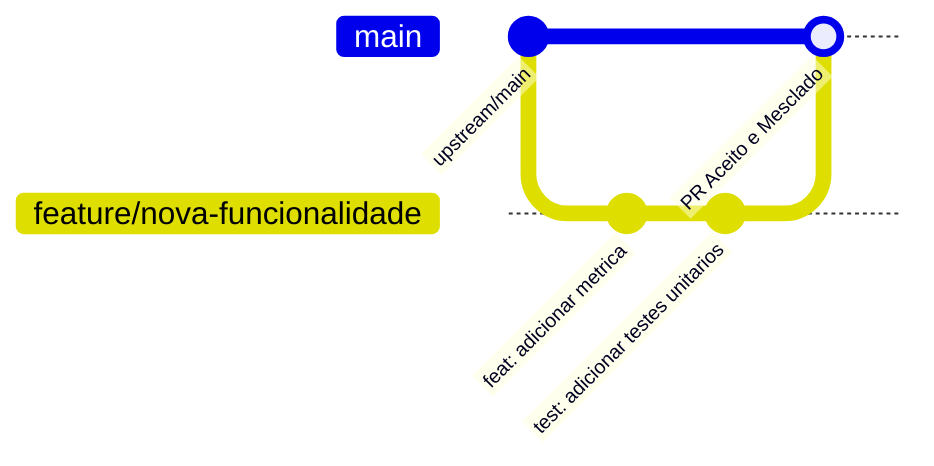

# Guia de Contribuição — GreenML Score 

Agradecemos imensamente o seu interesse em contribuir para o **GreenML Score** (`green-ml-score`)! Este é um framework Python de código aberto dedicado a mensurar, monitorar e reportar o impacto ambiental de modelos de Machine Learning (iniciativa *Green AI*). Toda e qualquer contribuição é bem-vinda para tornar o desenvolvimento de inteligência artificial mais sustentável, consciente e rigoroso.

Este documento estabelece as diretrizes, padrões de código e o fluxo de trabalho recomendados para que você possa colaborar de forma eficiente e harmoniosa com o projeto.

---

## Sumário

1. [Como Contribuir](#1-como-contribuir)
2. [Pré-requisitos](#2-pré-requisitos)
3. [Configuração do Ambiente de Desenvolvimento](#3-configuração-do-ambiente-de-desenvolvimento)
4. [Padrões de Código e Qualidade](#4-padrões-de-código-e-qualidade)
5. [Fluxo de Contribuição](#5-fluxo-de-contribuição)
6. [Convenções de Commit](#6-convenções-de-commit)
7. [Reportando Bugs](#7-reportando-bugs)
8. [Sugerindo Melhorias](#8-sugerindo-melhorias)

---

## 1. Como Contribuir

Existem diversas maneiras de fazer parte do GreenML Score. A comunidade valoriza todas as formas de colaboração:

- **Código:** Implementação de novas funcionalidades, criação de wrappers para outros frameworks de Machine Learning (PyTorch, TensorFlow, LightGBM, etc.), otimizações de performance e correções de defeitos (*bugs*).
- **Documentação:** Melhoria ou expansão dos manuais de uso, escrita de tutoriais, adição de exemplos práticos e aprimoramento de *docstrings*.
- **Testes:** Criação de novos casos de teste unitários e de integração, garantindo que os cálculos matemáticos do *GreenML Score* permaneçam estáveis e determinísticos.
- **Relato de Problemas:** Abertura de *issues* bem documentadas relatando falhas ou comportamentos inconsistentes.
- **Sugestão de Ideias:** Discussão e proposição de novos recursos e melhorias arquiteturais.
- **Revisão de Código (*Code Review*):** Revisão colaborativa e sugestões construtivas em *Pull Requests* de outros contribuidores.

> [!NOTE]
> Esperamos que todas as interações no repositório mantenham um tom profissional, respeitoso, empático e colaborativo, acolhendo contribuidores de todos os níveis de experiência.

---

## 2. Pré-requisitos

Antes de iniciar a configuração do ambiente, certifique-se de possuir as ferramentas básicas instaladas em seu sistema:

| Ferramenta | Versão Recomendada | Finalidade |
| :--- | :--- | :--- |
| **Python** | `3.10+` | O framework é testado e suportado oficialmente em Python `3.10`, `3.11`, `3.12` e `3.13`. |
| **Git** | Versão recente | Para versionamento e envio de branches. |
| **pip** | Atualizado | Gerenciador de pacotes padrão do Python (`python -m pip install --upgrade pip`). |

> [!TIP]
> Embora a suíte de testes unitários execute com mocks e emulações em qualquer máquina (sem depender de hardware específico), medições físicas em tempo real utilizam a biblioteca [CodeCarbon](https://github.com/mlco2/codecarbon). Em Linux com Intel RAPL ou em placas NVIDIA com NVML, o CodeCarbon lê a potência do hardware; no Windows, sem RAPL, a energia da CPU é estimada pela carga sobre o TDP (`cpu_load`), como nas medições do TCC (ver `docs/ambiente_medicao.md`).

---

## 3. Configuração do Ambiente de Desenvolvimento

Siga os passos abaixo para configurar o ambiente local de desenvolvimento de forma isolada.

### 3.1. Faça o Fork e Clone o Repositório

1. Acesse o repositório principal no GitHub: [https://github.com/OctavioSB11/TCC-Green-ML-Score](https://github.com/OctavioSB11/TCC-Green-ML-Score).
2. Clique no botão **Fork** (canto superior direito) para criar uma cópia em sua conta pessoal.
3. Clone o seu *fork* localmente:

```bash
git clone https://github.com/SEU-USUARIO/TCC-Green-ML-Score.git
cd TCC-Green-ML-Score
```

4. Configure o repositório original como remoto `upstream` para manter sua branch sincronizada:

```bash
git remote add upstream https://github.com/OctavioSB11/TCC-Green-ML-Score.git
```

### 3.2. Crie e Ative um Ambiente Virtual

Recomenda-se fortemente o uso de um ambiente virtual para não poluir o interpretador global:

- **Linux / macOS:**
  ```bash
  python3 -m venv .venv
  source .venv/bin/activate
  ```

- **Windows (PowerShell):**
  ```powershell
  python -m venv .venv
  .\.venv\Scripts\Activate.ps1
  ```

- **Windows (Prompt de Comando - CMD):**
  ```cmd
  python -m venv .venv
  .\.venv\Scripts\activate.bat
  ```

### 3.3. Instale em Modo Editável com Dependências de Desenvolvimento

Com o ambiente virtual ativado, atualize o `pip` e instale o pacote em modo editável (`-e`) com as dependências do grupo `[dev]`:

```bash
python -m pip install --upgrade pip
pip install -e .[dev]
```

> [!NOTE]
> Em terminais baseados em zsh (comum no macOS e em algumas distribuições Linux), utilize aspas para evitar a expansão de colchetes:
> ```bash
> pip install -e ".[dev]"
> ```

Se for trabalhar em experimentos ou integrações com redes neurais e NLP, instale também as dependências opcionais de experimentos:

```bash
pip install -e ".[dev,experiments]"
```

---

## 4. Padrões de Código e Qualidade

Para manter a base de código limpa, legível e confiável, adotamos ferramentas consagradas de linting, formatação e testes contínuos integradas ao GitHub Actions.

### 4.1. Linting com Ruff

Utilizamos o [Ruff](https://github.com/astral-sh/ruff) para análise estática de código.

Para inspecionar todo o projeto em busca de violações de estilo ou más práticas:

```bash
ruff check .
```

Para aplicar automaticamente as correções seguras suportadas:

```bash
ruff check --fix .
```

### 4.2. Formatação com Black

Utilizamos o [Black](https://github.com/psf/black) para garantir a formatação uniforme de todo o código Python.

Para formatar automaticamente os arquivos:

```bash
black .
```

Para verificar se algum arquivo viola o padrão de formatação (sem modificá-lo):

```bash
black --check .
```

### 4.3. Testes Automatizados com Pytest

A confiabilidade das métricas ambientais (consumo de energia, intensidade de carbono, pegada hídrica e o cálculo composto do GMS) é indispensável. Todos os testes devem ser executados e aprovados antes de qualquer submissão.

Para executar todos os testes com cobertura:

```bash
pytest --cov=green_ml_score
```

Para gerar o relatório detalhado informando linhas não cobertas:

```bash
pytest --cov=green_ml_score --cov-report=term-missing
```

> [!IMPORTANT]
> - Não serão aceitos Pull Requests que reduzam a cobertura de testes do projeto.
> - Toda nova funcionalidade ou correção de bug deve vir acompanhada de testes unitários ou de integração correspondentes no diretório `tests/`.

---

## 5. Fluxo de Contribuição

Adotamos o fluxo padrão de código aberto baseado em *branches*, *commits* atômicos e *Pull Requests*:



### Guia Passo a Passo

1. **Sincronize sua branch `main` local com o upstream:**
   ```bash
   git checkout main
   git fetch upstream
   git merge upstream/main
   ```

2. **Crie uma branch temática:**
   Crie uma branch específica para o seu trabalho, utilizando nomes claros e com o prefixo apropriado:
   ```bash
   git checkout -b <tipo>/<descricao-curta>
   ```
   *Exemplos:*
   - `feat/wrapper-xgboost`
   - `fix/calculo-pegada-hidrica`
   - `docs/exemplos-mlflow`
   - `test/cobertura-tracker`

3. **Desenvolva as alterações:**
   - Siga os padrões de código, documente funções e classes com *docstrings* claras.
   - Adicione anotações de tipos (*type hints*) sempre que viável.
   - Escreva testes correspondentes em `tests/`.

4. **Valide a qualidade localmente:**
   Antes de comitar, certifique-se de que todas as validações passam sem erros:
   ```bash
   ruff check .
   black --check .
   pytest --cov=green_ml_score --cov-report=term-missing
   ```

5. **Faça o commit seguindo as convenções:**
   ```bash
   git add .
   git commit -m "feat(integrations): adicionar wrapper para modelos xgboost"
   ```

6. **Envie para o seu fork:**
   ```bash
   git push origin <tipo>/<descricao-curta>
   ```

7. **Abra um Pull Request (PR):**
   - Acesse o repositório original [OctavioSB11/TCC-Green-ML-Score](https://github.com/OctavioSB11/TCC-Green-ML-Score).
   - Clique em **New Pull Request** e selecione sua branch.
   - Direcione o PR para a branch `main` do repositório base.
   - Preencha o título e a descrição de forma detalhada, explicando o contexto, as mudanças realizadas e como testá-las.
   - Referencie issues relacionadas se houver (ex.: `Resolve #10`).
   - Acompanhe os testes automatizados da pipeline de CI no GitHub Actions.
   - Responda aos comentários da revisão de código (*code review*) e realize ajustes se solicitado.

---

## 6. Convenções de Commit

Adotamos a convenção de [Conventional Commits](https://www.conventionalcommits.org/pt-br/v1.0.0/). Isso mantém o histórico de commits organizado e possibilita a geração automatizada de notas de versão (*release notes*).

### Estrutura da Mensagem

```text
<tipo>[escopo opcional]: <descrição concisa no modo imperativo>

[corpo opcional explicando o motivo da alteração]

[rodapé opcional com referências a issues, ex.: Fixes #12]
```

### Tipos Aceitos

| Tipo | Finalidade | Exemplo |
| :--- | :--- | :--- |
| `feat` | Nova funcionalidade para o usuário ou biblioteca | `feat(tracker): adicionar medicao de consumo de memoria RAM` |
| `fix` | Correção de defeito (*bug*) no código | `fix(scoring): corrigir normalizacao com bounds maximos nulos` |
| `docs` | Alterações puramente em documentação | `docs: detalhar integracao com MLflow no README` |
| `test` | Inclusão ou modificação de testes automatizados | `test(sklearn): adicionar testes com RandomForestClassifier` |
| `refactor` | Refatoração de código sem alteração funcional | `refactor(tracker): modularizar extracao do emissions.csv` |
| `perf` | Otimização de desempenho ou tempo de processamento | `perf(scoring): vetorizar calculo das pontuacoes parciais` |
| `chore` | Alterações em ferramentas de build, dependências ou tarefas | `chore(deps): atualizar dependencia do scikit-learn` |
| `ci` | Modificações em scripts e configurações do GitHub Actions | `ci: adicionar execucao de testes no python 3.13` |

### Boas Práticas para Commits:
- Descreva a ação no tempo presente/imperativo (ex.: `adicionar`, `corrigir`, `atualizar`).
- A primeira linha deve ter no máximo 72 caracteres e não deve terminar com ponto final.
- Evite commits aglutinados com alterações não relacionadas; divida em commits atômicos e coesos.

---

## 7. Reportando Bugs

Encontrou um erro, falha ou resultado divergente da fórmula matemática proposta? Fique à vontade para relatar abrindo uma *issue* no GitHub!

### Antes de Enviar:
1. Pesquise nas [Issues abertas e fechadas](https://github.com/OctavioSB11/TCC-Green-ML-Score/issues) para conferir se o problema já foi reportado ou solucionado.
2. Certifique-se de que suas dependências e a versão do projeto estão atualizadas.

### Template Sugerido para Relato de Bug:

```markdown
### Descrição do Problema
Uma descrição clara e concisa do comportamento inesperado encontrado.

### Passos para Reproduzir
1. Inicializar o wrapper com as opções '...'
2. Invocar o método `.fit()` com os dados '...'
3. Obter a exceção/erro no console.

### Exemplo Mínimo Reproduzível (MRE)
```python
import mlflow
from green_ml_score.integrations.sklearn import GreenMLSklearnWrapper

# Código simplificado que reproduz a falha
```

### Comportamento Esperado
O que deveria acontecer quando o código fosse executado corretamente.

### Logs e Stack Trace
Cole a saída de erro completa gerada pelo terminal:
```text
Traceback (most recent call last):
  File "...", line ..., in ...
    ...
```

### Informações do Ambiente
- **Sistema Operacional:** [ex.: Windows 11, Ubuntu 22.04, macOS Sonoma]
- **Versão do Python:** [ex.: 3.11.8]
- **Versão do GreenML Score:** [ex.: 0.1.0 ou hash do commit]
- **Hardware:** [ex.: CPU Intel i7 13ª geração, GPU NVIDIA RTX 4070]
- **Versões das Bibliotecas Principais:**
  - `codecarbon`:
  - `mlflow`:
  - `scikit-learn`:

### Informações Adicionais
Capturas de tela, contexto do experimento ou observações complementares.
```

> [!CAUTION]
> Certifique-se de nunca incluir informações sensíveis nos logs ou descrições, tais como credenciais, segredos, senhas ou dados proprietários.

---

## 8. Sugerindo Melhorias

Adoramos ideias para tornar o GreenML Score ainda mais completo e relevante para o ecossistema de *Green AI*!

Para propor uma melhoria, otimização ou nova integração:

1. Acesse a aba [Issues](https://github.com/OctavioSB11/TCC-Green-ML-Score/issues) do projeto.
2. Crie uma nova issue e forneça as seguintes informações estruturadas:

```markdown
### Contexto e Motivação
Qual necessidade ou problema motivou esta sugestão? Por que essa funcionalidade seria benéfica para os usuários do GreenML Score?

### Solução Proposta
Descreva com clareza o comportamento da funcionalidade proposta. Se aplicável, demonstre um exemplo conceitual de uso:

```python
# Exemplo de uso da API proposta
```

### Alternativas Consideradas
Existem outras formas ou ferramentas que solucionam isso hoje? Por que a proposta sugerida é preferível?

### Impacto no Green AI
De que maneira essa alteração contribui para o cálculo mais preciso, acessível ou padronizado de sustentabilidade em Machine Learning?
```

---

## Mantenedores e Contato

O **GreenML Score** é mantido ativamente por:
- **Octavio Bordotti**
- **Danilo Parolin**

- **Repositório:** [https://github.com/OctavioSB11/TCC-Green-ML-Score](https://github.com/OctavioSB11/TCC-Green-ML-Score)
- **Central de Issues:** [https://github.com/OctavioSB11/TCC-Green-ML-Score/issues](https://github.com/OctavioSB11/TCC-Green-ML-Score/issues)
- **Pull Requests:** [https://github.com/OctavioSB11/TCC-Green-ML-Score/pulls](https://github.com/OctavioSB11/TCC-Green-ML-Score/pulls)

Agradecemos profundamente pela sua contribuição para uma Inteligência Artificial mais verde e sustentável! 
