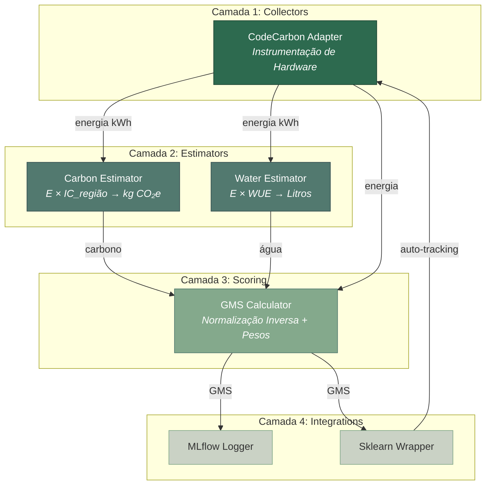
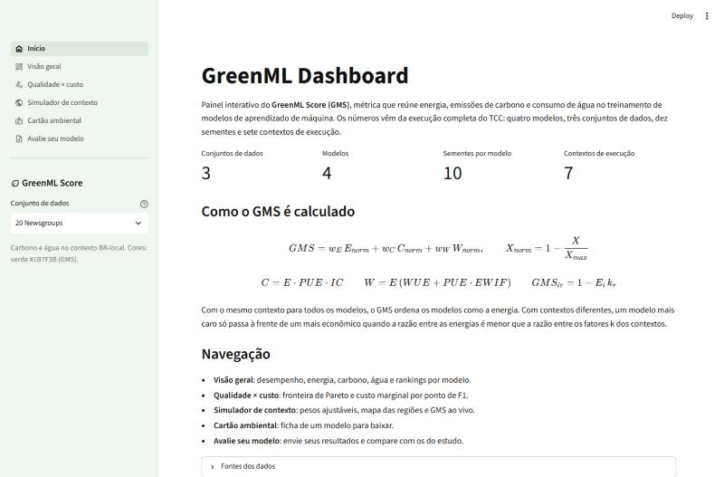
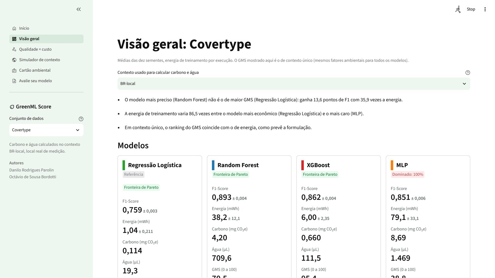
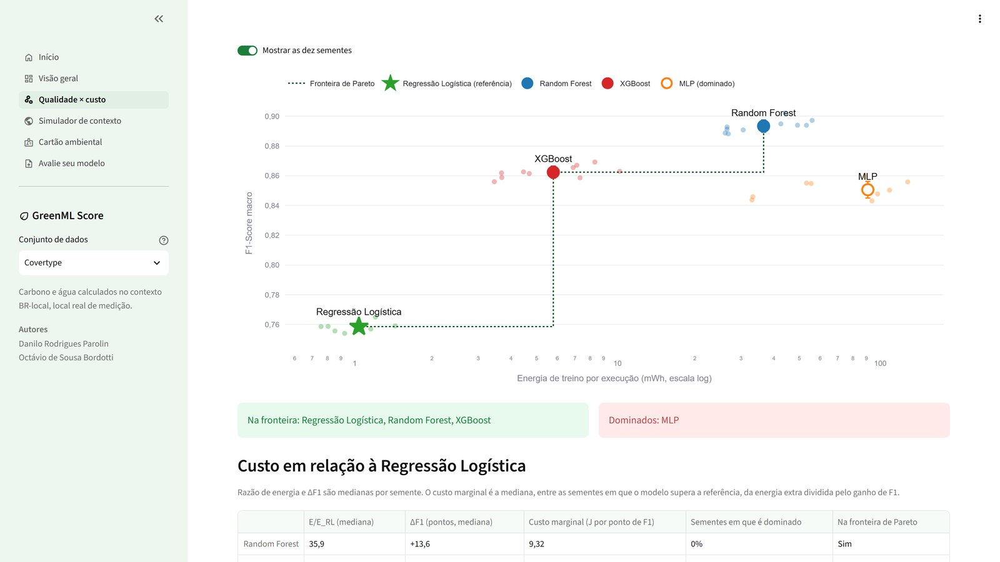
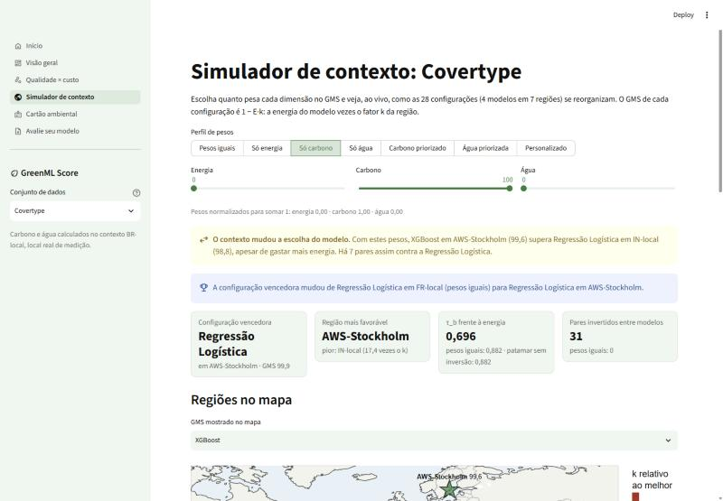
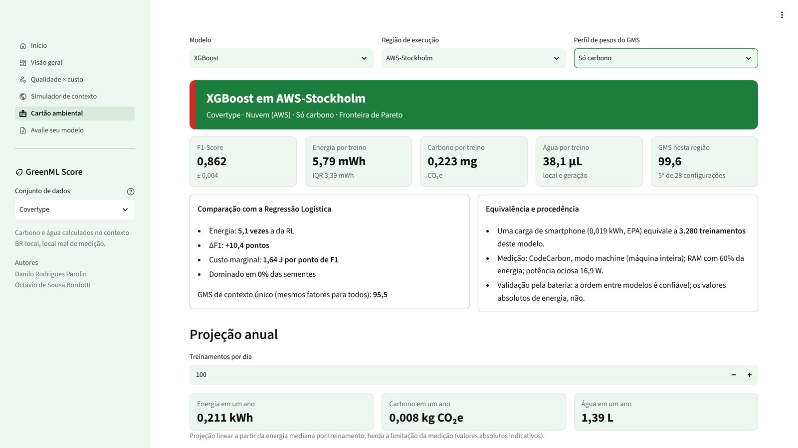
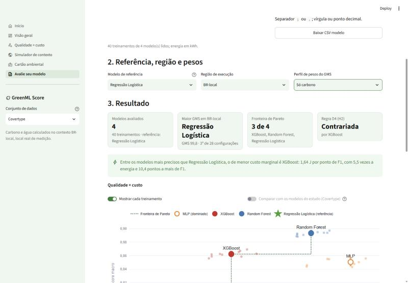

<p align="center">
  <strong> GreenML Score Framework</strong>
</p>

<p align="center">
  <em>Métrica ambiental composta para avaliação da sustentabilidade em modelos de Machine Learning</em>
</p>

<p align="center">
  <a href="https://github.com/OctavioSB11/TCC-Green-ML-Score/actions/workflows/ci.yml">
    
  </a>
  <a href="https://github.com/OctavioSB11/TCC-Green-ML-Score/blob/main/LICENSE">
    
  </a>
  
  
  
  
</p>

---

## Sobre o Projeto

O **GreenML Score** é um framework Python profissional e automatizado para **medir, rastrear e reportar o impacto ambiental de modelos de Machine Learning**.

Enquanto a maioria das ferramentas de ML foca exclusivamente em métricas preditivas como Acurácia e F1-Score (*Red AI*), o GreenML traz a **sustentabilidade para o centro da tomada de decisão** (*Green AI*), combinando monitoramento de hardware em tempo real com uma métrica composta: o **GreenML Score (GMS)**.

### O que ele mede?

| Dimensão | Unidade | Fonte |
|---|---|---|
| **Consumo Energético** | kWh | [CodeCarbon](https://github.com/mlco2/codecarbon) (RAPL / NVML) |
| **Emissões de Carbono** | kg CO₂e | `C = E × PUE × IC` (fatores do contexto de execução) |
| **Pegada Hídrica** | Litros | `W = E × (WUE + PUE × EWIF)` (resfriamento e geração elétrica) | ---

## A Métrica: GreenML Score (GMS)

O GMS é uma métrica composta que pertence ao intervalo **[0, 1]** (ou **[0, 100]** na escala operacional). Valores maiores representam modelos **mais sustentáveis e eficientes**.

### Fórmula Matemática

```
GMS = w_E · Ê + w_C · Ĉ + w_W · Ŵ
```

Onde cada componente normalizado usa **normalização inversa**:

```
X̂ = 1 − (X / X_max)
```

| Símbolo | Descrição | Padrão |
|---|---|---|
| `w_E` | Peso da dimensão energética | 1/3 |
| `w_C` | Peso da dimensão de carbono | 1/3 |
| `w_W` | Peso da dimensão hídrica | 1/3 |
| `X_max` | Maior valor observado no conjunto de modelos comparados | Auto | > **Interpretação:** Quanto menor o consumo de recursos (energia, carbono, água), maior o GMS. Um GMS de 100 indica o modelo mais eficiente do grupo; um GMS próximo de 0 indica o mais custoso.

### Pesos Contextuais (Seção 7 do TCC)

Os pesos podem ser ajustados conforme o contexto operacional:

| Cenário | `w_E` | `w_C` | `w_W` | Justificativa |
|---|:---:|:---:|:---:|---|
| Neutro (padrão) | 1/3 | 1/3 | 1/3 | Sem viés dimensional |
| Alta intensidade de carbono | 0.2 | 0.5 | 0.3 | Regiões com grid elétrico fóssil |
| Estresse hídrico | 0.3 | 0.2 | 0.5 | Data centers em regiões áridas | ---

## Arquitetura

O framework é organizado em **4 camadas** independentes e desacopladas:



---

## Instalação

```bash
# Clone o repositório
git clone https://github.com/OctavioSB11/TCC-Green-ML-Score.git
cd TCC-Green-ML-Score

# Instale em modo editável com dependências de desenvolvimento
pip install -e .[dev]
```

### Dependências Opcionais

```bash
# Para executar os experimentos comparativos (XGBoost, datasets HuggingFace, etc.)
pip install -e .[experiments]

# Para abrir o painel interativo (Streamlit, Plotly e matplotlib; Python 3.11 ou superior)
pip install -e .[app]
```

---

## Como Usar

### Integração com Scikit-Learn (Fricção Zero)

O framework foi projetado para exigir **mínima alteração** no seu código existente:

```python
import mlflow
from sklearn.ensemble import RandomForestClassifier
from green_ml_score.integrations.sklearn import GreenMLSklearnWrapper
from green_ml_score.scoring import NormalizationBounds

# 1. Defina seus limites máximos teóricos (para a normalização do GMS)
bounds = NormalizationBounds(energy_max=1.5, carbon_max=0.2, water_max=2.7)

# 2. Inicialize o MLflow
mlflow.set_experiment("GreenML_Demonstration")

with mlflow.start_run():
    # 3. Envolva seu modelo com o Wrapper
    base_model = RandomForestClassifier()
    green_model = GreenMLSklearnWrapper(
        base_model,
        bounds=bounds,
        tracker_kwargs={
            "carbon_intensity_g_per_kwh": 106.06,  # Brasil 2024 (Ember)
            "wue_liters_per_kwh": 0.30,  # Microsoft FY24
        },
    )

    # 4. Ao chamar .fit(), o Tracker liga automaticamente em background!
    green_model.fit(X_train, y_train)
    # → Métricas ambientais logadas automaticamente no MLflow 
```

### Uso Direto da API de Scoring

```python
from green_ml_score import (
    EnvironmentalMetrics,
    NormalizationBounds,
    Weights,
    calculate_gms,
    explain_gms,
)

# Métricas coletadas de um modelo treinado
metrics = EnvironmentalMetrics(energy=0.05, carbon=0.006, water=0.026)
bounds = NormalizationBounds(energy_max=0.1, carbon_max=0.012, water_max=0.052)

# GMS com pesos uniformes
score = calculate_gms(metrics, bounds, scale_100=True)
print(f"GreenML Score: {score:.2f} / 100")

# Decomposição por dimensão
decomposition = explain_gms(metrics, bounds)
print(decomposition)
# {'E_norm': 0.5, 'C_norm': 0.5, 'W_norm': 0.5, 'GMS': 0.5, ...}
```

---

## Resultados Experimentais

Resultados do artigo final ([`docs/artigo_final/`](docs/artigo_final/)): quatro
modelos (Regressão Logística, Random Forest, XGBoost e MLP), dez sementes por modelo,
três conjuntos de dados (20 Newsgroups, Breast Cancer Wisconsin e Covertype) e sete
contextos de execução descritos por fontes públicas (Ember, Reig et al. e AWS). Os
números vêm de `experiments/results/<dataset>/full/` e das tabelas do artigo; carbono
e água estão no contexto BR-local, local real de medição.

**Tabela 2 do artigo (média ± desvio padrão; GMS de contexto único):**

| Conjunto | Modelo | F1-Score | Energia (mWh) | Carbono (mg CO₂e) | Água (µL) | GMS |
|---|---|:---:|:---:|:---:|:---:|:---:|
| 20 Newsgroups | Regressão Logística | 0,936 ± 0,011 | 0,101 ± 0,021 | 0,011 | 1,9 | 99,8 ± 0,0 |
| | Random Forest | 0,894 ± 0,013 | 9,14 ± 2,55 | 1,00 | 170 | 78,5 ± 6,0 |
| | XGBoost | 0,869 ± 0,012 | 20,4 ± 5,1 | 2,24 | 378 | 52,1 ± 12,0 |
| | MLP | 0,934 ± 0,013 | 25,7 ± 8,9 | 2,82 | 477 | 39,5 ± 20,9 |
| Breast Cancer | Regressão Logística | 0,970 ± 0,012 | 0,023 ± 0,022 | 0,003 | 0,4 | 98,4 ± 1,5 |
| | Random Forest | 0,956 ± 0,013 | 0,938 ± 0,204 | 0,103 | 17,4 | 34,6 ± 14,2 |
| | XGBoost | 0,960 ± 0,017 | 0,828 ± 0,134 | 0,091 | 15,4 | 42,2 ± 9,4 |
| | MLP | 0,923 ± 0,028 | 0,312 ± 0,087 | 0,034 | 5,8 | 78,2 ± 6,0 |
| Covertype | Regressão Logística | 0,759 ± 0,003 | 1,04 ± 0,21 | 0,114 | 19,3 | 99,2 ± 0,2 |
| | Random Forest | 0,893 ± 0,004 | 38,2 ± 12,1 | 4,20 | 710 | 70,5 ± 9,4 |
| | XGBoost | 0,862 ± 0,004 | 6,00 ± 2,35 | 0,660 | 111 | 95,4 ± 1,8 |
| | MLP | 0,851 ± 0,006 | 79,1 ± 33,1 | 8,69 | 1469 | 38,8 ± 25,6 |

**Síntese das hipóteses (Tabela 6 do artigo):**

| Hipótese | 20 Newsgroups | Breast Cancer | Covertype |
|---|---|---|---|
| H1: a Regressão Logística gasta menos energia | Confirmada (Friedman, p = 3,5 × 10⁻⁶) | Confirmada (p = 4,7 × 10⁻⁶) | Confirmada (p = 1,4 × 10⁻⁶) |
| H2: os modelos mais caros são dominados ou gastam ao menos 10 vezes a energia da RL | Confirmada | Confirmada | Refutada (XGBoost na fronteira com 5,1 vezes a energia da RL) |
| H3: o contexto inverte pares no ranking | Confirmada (τb = 0,798; mínimo de 0,582) | Confirmada (τb = 0,786; mínimo de 0,576) | Confirmada com w_E < 0,4 (mínimo de 0,696) |
| H4: o contexto muda o modelo escolhido | Não confirmada | Não confirmada (só no vértice w_C = 1) | Parcialmente confirmada (11,3% das combinações de pesos) |

### Principais Conclusões

1. **A Regressão Logística foi a mais econômica** nos três conjuntos e em todas as sementes.
2. **No Covertype há compromisso real entre qualidade e custo:** o XGBoost ganha 10,4 pontos de F1 com 5,1 vezes a energia da RL, a 1,6 J por ponto de F1; o Random Forest ganha 13,6 pontos a 9,3 J por ponto.
3. **O contexto reordena as configurações** (τb de Kendall entre 0,58 e 0,88), mas só muda o modelo escolhido no Covertype e com pesos concentrados em carbono ou água: com todo o peso no carbono, o XGBoost em Estocolmo (GMS 99,6) supera a RL na rede indiana (98,8).
4. **Limitação da medição:** comparado à descarga da bateria, o CodeCarbon captou cerca de 7% do aumento real de consumo causado pela carga. A ordem entre os modelos é confiável; os valores absolutos de energia, carbono e água são indicativos.

> Gráficos e tabelas gerados pelos scripts estão em [`docs/Results/`](docs/Results/). Os mesmos números podem ser explorados no [painel interativo](#painel-interativo).

---

## Painel interativo

O **GreenML Dashboard** é um painel em [Streamlit](https://streamlit.io) que lê os
resultados de `experiments/results/*/full` e o `experiments/contexts/contexts.csv` e
mostra, sem refazer nenhum experimento, o que o artigo descreve. São seis telas:

| Tela | O que mostra |
|---|---|
| Início | o que é o GMS, de onde vêm os dados e como navegar |
| Visão geral | F1-Score, energia, carbono, água e GMS por modelo, com os rankings lado a lado |
| Qualidade × custo | gráfico F1 × energia com a fronteira de Pareto e o custo marginal frente à RL |
| Simulador de contexto | pesos ajustáveis, mapa das 7 regiões, GMS ao vivo e pares invertidos |
| Cartão ambiental | ficha de um modelo em uma região, para baixar em PNG, Markdown ou CSV |
| Avalie seu modelo | envio de um CSV próprio (modelo, f1, energia) e cálculo do GMS, da fronteira e da regra D4 |

**Windows (Prompt de Comando), na pasta do projeto:**

```bat
python -m venv .venv
.venv\Scripts\python.exe -m pip install -e ".[app]"
.venv\Scripts\python.exe -m streamlit run app\Home.py
```

**Linux ou macOS:**

```bash
python3 -m venv .venv
.venv/bin/python -m pip install -e ".[app]"
.venv/bin/python -m streamlit run app/Home.py
```

O painel exige Python 3.11 ou superior (a biblioteca funciona a partir do 3.10) e abre
em `http://localhost:8501`. Funciona sem internet, exceto o mapa de
fundo do simulador, baixado pelo Plotly (os pontos das regiões aparecem mesmo
offline).

| | |
|---|---|
|  |  |
|  |  |
|  |  |

O plano de construção e as decisões estão em [`docs/plano_painel.md`](docs/plano_painel.md).

---

## Visualizando Resultados no MLflow

```bash
mlflow ui
```

Abra o navegador em `http://127.0.0.1:5000` para visualizar todas as métricas ambientais e o GMS registrados automaticamente.

---

## Testes

A bateria de testes (pytest) cobre a biblioteca, os scripts de experimento e o painel
(camada de dados, gráficos, cartão, envio de CSV e as seis telas via
`streamlit.testing`, sem abrir servidor). Os testes do painel conferem os números com
as tabelas do artigo e não precisam de internet.

```bash
# Rodar todos os testes
pytest

# Rodar com relatório de cobertura da biblioteca e do painel
pytest --cov=green_ml_score --cov=app --cov-report=term-missing
```

---

## Estrutura do Projeto

```
TCC-Green-ML-Score/
├── green_ml_score/            # Código-fonte do framework
│   ├── collectors/            # Camada 1: Adaptadores de instrumentação (CodeCarbon)
│   ├── estimators/            # Camada 2: Carbono (E×IC) e Água (E×WUE)
│   ├── scoring/               # Camada 3: Cálculo do GMS, normalização, pesos
│   └── integrations/          # Camada 4: MLflow logger, Sklearn wrapper
├── app/                       # Painel interativo (Streamlit)
│   ├── Home.py                # Ponto de entrada: streamlit run app/Home.py
│   ├── core/                  # Dados, gráficos, cartão e envio de CSV (sem Streamlit)
│   └── views/                 # Uma página por tela
├── experiments/               # Experimento comparativo e geração de resultados
│   ├── comparative_experiment.py
│   ├── generate_results.py
│   ├── config.py
│   └── results/               # Dados brutos do experimento
├── tests/                     # Testes (pytest) da biblioteca, dos experimentos e do painel
├── docs/
│   ├── Diagrams/              # Diagramas de arquitetura (.drawio)
│   ├── Results/               # Gráficos e tabelas gerados
│   ├── artigo_final/          # Artigo final (.doc, .docx e .pdf)
│   └── painel/capturas/       # Capturas de tela do painel
├── .github/workflows/ci.yml   # CI: Ruff + Black + Pytest (Python 3.10–3.13)
├── pyproject.toml             # Configuração do projeto e dependências
├── CHANGELOG.md               # Histórico de versões
├── CONTRIBUTING.md            # Guia para contribuidores
├── LICENSE                    # MIT License
└── README.md                  # Este arquivo
```

---

## Citação (BibTeX)

Se este framework ou o artigo associado foi útil para a sua pesquisa, por favor cite:

```bibtex
@software{greenml_score_2026,
  title     = {GreenML Score: Framework para Avaliação e Rastreamento do Impacto Ambiental em Modelos de Machine Learning},
  author    = {Bordotti, Octavio and Parolin, Danilo},
  year      = {2026},
  url       = {https://github.com/OctavioSB11/TCC-Green-ML-Score},
  version   = {0.1.0},
  license   = {MIT}
}
```

---

## Contribuindo

Contribuições são bem-vindas! Consulte o guia completo em [`CONTRIBUTING.md`](CONTRIBUTING.md).

```bash
# Resumo rápido
git clone https://github.com/OctavioSB11/TCC-Green-ML-Score.git
cd TCC-Green-ML-Score
pip install -e .[dev]
ruff check .          # Linting
black .               # Formatação
pytest                # Testes
```

---

## Licença

Este projeto está licenciado sob a [MIT License](LICENSE).

---

## Autores

- **Octavio Bordotti**: [GitHub](https://github.com/OctavioSB11)
- **Danilo Parolin**

**Trabalho de Conclusão de Curso (TCC)**, 2026
